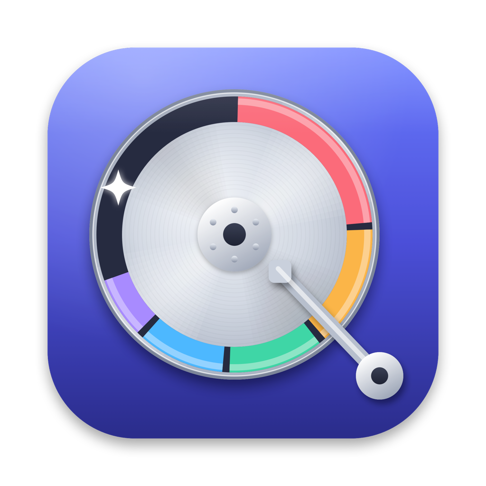
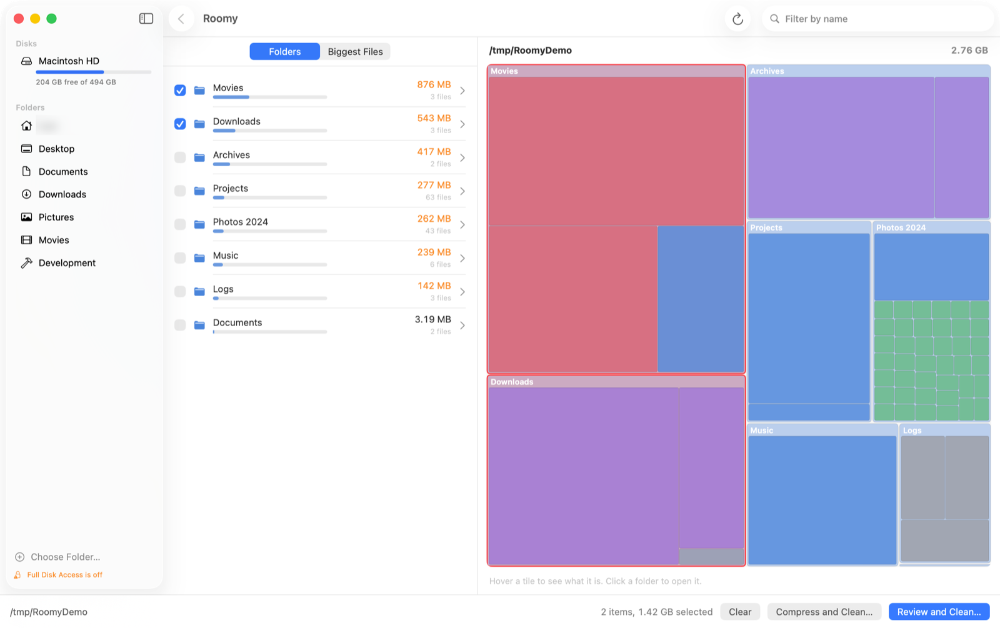
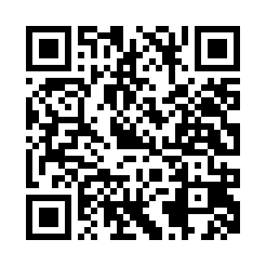

<p align="center"></p>

# RoomyDisk

A macOS app that shows what is using space on your disk and helps you free it up safely.



*Folders sorted by size on the left and a treemap of the same folder on the right, with two items ticked for cleanup.*

- **Scan** your home folder, any folder or a whole disk. Folders are read in parallel and hard links are counted once.
  **APFS clones** (copies made with Finder's Duplicate, `cp -c` or apps that clone) share their blocks on disk, so the
  space they share is counted once too: the first clone found carries it, and each other clone adds only the space that
  is its own. A clone shows a small two-squares icon; hover or select it to see "Shares 1.2 GB with 2 clones". Moving a
  clone to the Trash frees only its own space, and the review says so. A clone that was changed after copying gets
  its own id from macOS and is counted in full.
- **See** it as a list, a list of the biggest files (filter by kind and age) or a treemap.
- **See it as rings**: switch the map between **Treemap** and **Rings**. The rings chart shows four levels around the
  open folder, each item's angle by its size and coloured like the treemap; hover for its name and size, click a folder
  to zoom in and click the centre to go up.
- **Quick Look**: select an item in a list, the treemap or the rings and press Space (or ⌘Y). The arrow keys move the
  preview through the list.
- **Collect** items in the **tray** at the bottom of the window: drag them there from any list, the treemap or the
  rings, choose **Add to Tray** in the context menu, or tick them. The tray shows each item with its size and the total,
  and **Review and Clean…** moves them to the Trash after you review them, so Put Back still works.
- **Fast reopening**: each scan is cached in `~/Library/Caches/io.github.hoangtuanbs.Roomy/Scans`, so the last scan of
  a folder shows at once, with a "Scanned 2 hours ago · Rescan" note, while a fresh scan runs behind it. **Rescan This
  Folder** in the context menu scans just that folder again and updates the totals around it.
- **Smart Clean** (top of the sidebar, the toolbar, or ⇧⌘K) finds junk that is safe to remove: app caches, logs,
  Xcode build data, device support files and simulator caches, package manager caches (npm, Yarn, pnpm, pip, Homebrew,
  CocoaPods, Gradle, Cargo) and installers in Downloads older than 30 days. Xcode archives, simulators unused for
  6 months and `node_modules` folders untouched for 30 days in the scanned folder are listed too, but start unticked
  so you can review them. Each card says what the files are and what happens if you remove them; open a card to untick
  single items. **Clean** moves the ticked items to the Trash. Caches of macOS and of apps that are open are left alone.
  The Trash is shown on its own card, and emptying it, the one thing that cannot be undone, asks first.
- **Disk overview** above the results shows where the disk's space goes, like DaisyDisk: a bar with what the scan
  found, **hidden** space (used, but not found: files RoomyDisk cannot read without Full Disk Access, macOS system files and
  snapshots), **purgeable** space (local snapshots, iCloud files and caches macOS frees on its own) and free space.
  Click a part to learn what it is. It also lists the disk's **local snapshots** with their dates; a Time Machine
  snapshot can be deleted after a confirmation (`tmutil deletelocalsnapshots`, no admin rights). **Free Purgeable
  Space…** asks Time Machine to thin its snapshots (`tmutil thinlocalsnapshots`), or open Storage Settings instead.
  Neither can be undone, so both ask first.
- **Duplicates** (below Smart Clean in the sidebar, the toolbar, or ⇧⌘D) finds identical files of 1 MB or more in
  the current scan, or in a folder you choose. Files of the same size are compared by their first and last 64 KB, and
  only those that still match are read in full (SHA-256). Hard links, symbolic links, empty files, packages such as
  apps and Photos libraries, Git folders and protected places are left out. Each set of copies is a card, largest
  waste first, with thumbnails; one copy is kept (the oldest one with the plainest path, not one in Downloads or the
  Trash or named like "photo copy.jpg"), and you can pick another with its **Keep** button. **Move Duplicates to
  Trash** moves the rest to the Trash, never every copy.
- **Uninstaller** (below Duplicates in the sidebar, the toolbar, or ⇧⌘U) lists the apps in `/Applications` and
  `~/Applications` with their icons, sizes and when you last used them; search them and sort by size, name or last
  use. Choose an app to see its bundle and the files it left in your Library, grouped (app data, caches, settings,
  saved window state, sandbox and shared containers, web storage, WebKit data, cookies, logs and launch agents).
  Only items named exactly by the app's bundle identifier or exact name count, never another app's files or a name
  shared by a maker's apps. Items named by a longer, related identifier (such as `com.google.Chrome.canary` for Chrome)
  may belong to another app, so they start unticked with a **Review first** badge. **Uninstall** moves the ticked
  items to the Trash. Apps of macOS are not listed, and an app
  that is open has to be quit first. Apps from the App Store or installed for all users may need an administrator;
  RoomyDisk says so and never asks for one. **Leftovers of removed apps** lists Library items named after apps that are
  no longer installed. They are guesses, so nothing there is ticked until you review it.
- **Space Hunters** (below the Uninstaller in the sidebar, the toolbar, or ⇧⌘H) hunts for big things you may have
  forgotten, each on its own card with a total that counts up:
  - **iPhone & iPad backups** in `~/Library/Application Support/MobileSync/Backup`, with the device's name, model,
    iOS version, date and whether the backup is encrypted. Only an older backup of a device that has a newer one, made
    90 days ago or more, starts ticked; the newest backup of each device never does. Backups are only ever moved whole.
    macOS protects this folder, so RoomyDisk needs Full Disk Access to see them and says so.
  - **Old downloads**: items in Downloads you have not opened (Spotlight's last-used date), added or changed for 90
    days, largest first. Nothing is ticked; preview them with Quick Look first.
  - **Mail attachments**: the attachments in Mail's own folder are only shown, with **Open in Finder** and how to
    remove them in Mail (Message > Remove Attachments), because removing them in Finder can damage Mail. Copies of
    attachments you opened (Mail Downloads) can go to the Trash; they start unticked, since you may have edited one.
  - **Similar photos**: JPEG, HEIC and PNG pictures in the current scan (or `~/Pictures`) that look almost the same,
    compared with Vision and by when they were taken, up to the 3,000 largest. Pictures in Photos libraries are never
    touched. The one with the most pixels, then the newest, is suggested to keep; nothing is ticked, and one picture of
    each group always stays.
- **Cloud Space** (below Space Hunters in the sidebar, the toolbar, or ⇧⌘L, "Free Up Cloud Space…") frees space
  without deleting anything: it removes the downloaded copies of files kept in **iCloud Drive** (and apps' iCloud
  folders in `~/Library/Mobile Documents`) and in **Dropbox, OneDrive, Google Drive and Box** (`~/Library/CloudStorage`).
  Each service gets a card with its folders, the space their local copies take, and a tick for each folder; nothing
  starts ticked. **Remove Downloads** asks macOS to evict each file (`FileManager.evictUbiquitousItem`), the same as
  Finder's **Remove Download**: the files stay in the cloud and download again when you open them. Files are never moved
  or deleted. A file whose changes have not reached the cloud yet, that is still uploading, whose state is unknown, or
  that has conflicting versions is kept and labelled ("Not uploaded yet — kept"); each file is checked again just
  before. If **Optimize Mac Storage** is off for iCloud Drive, macOS may download files again on its own. Very large
  cloud folders are checked up to 250,000 files each.
- **Disk Health** (below Cloud Space in the sidebar, the toolbar, the menu bar popover, or ⇧⌘I) shows a card for every
  internal and external disk: its model, connection (Apple Fabric, PCI Express, USB, Thunderbolt, SATA), whether it is
  an SSD, its size and how much of it is used, the firmware, the serial number (mostly hidden) and its **S.M.A.R.T.**
  status. Each disk gets a verdict, **Good**, **Warning**, **Failing** or **Unknown**, with what it means and what to do
  ("Back up now with Time Machine, then replace this disk"). It is strictly read-only and needs no admin rights: it reads
  the I/O Registry and asks `diskutil info` and `system_profiler`, each with a 10-second limit, away from the main
  thread. Wear, power-on hours and temperature are only given to admin tools on macOS, so they say "Not available
  without admin rights" instead of a made-up number. Many USB drives, card readers and virtual disks don't report
  their health; they show **Unknown**. The menu bar popover shows a dot in the health's colour next to each disk.
  RoomyDisk reads the disks every 6 hours while it runs, and sends one notification if a disk turns **Failing**;
  clicking it opens Disk Health.
- **Settings** (⌘,) has three tabs: **General** (the menu bar icon), **Checks & Alerts** (automatic checks, their
  notice and the low-space alert) and **Updates**.
- **Menu bar** (on by default, turn it off in Settings › General): an icon in the menu bar shows the startup disk and any
  external disks with a bar for how full they are, their free space and a health dot, refreshed every minute and when you open it.
  **Open RoomyDisk**, **Smart Clean…**, **Disk Health…** and **Quit** are a click away. RoomyDisk keeps running in the menu bar after its window closes.
- **Automatic checks and Quick Clean** (Settings › Checks & Alerts): while RoomyDisk runs, it looks at the places Smart Clean knows
  (never the whole disk) every 6 hours, a minute after launch and after the Mac wakes; choose every hour, once a day or
  Off. Checks run at low priority and wait while the Mac is on a battery below 20% or in Low Power Mode. The menu bar
  popover shows **Can be freed**: the total, a bar per kind of junk and when it last looked. **Quick Clean** moves only
  what Smart Clean ticks by itself (app caches, logs, Xcode build data, package caches, old installers) to the Trash, after you confirm
  ("Move 3.2 GB of caches and logs to the Trash?") right in the popover. Nothing is ever removed without that click. After a relaunch only the totals are
  remembered, so opening the popover looks again at once and Quick Clean is ready a few seconds later.
  Above 1 GB the amount also shows next to the menu bar icon ("3.2G"; turn it off or raise it in Settings). When more
  than 5 GB can be freed (2 to 20 GB), RoomyDisk sends at most one notification every 3 days, "RoomyDisk can free
  7.4 GB of caches and logs"; clicking it opens Smart Clean, even with the menu bar icon turned off.
- **Low-space alert** (Settings › Checks & Alerts): when the startup disk has less than 10 GB free (you choose 5 to 100 GB), RoomyDisk sends one
  notification a day, "Your disk is almost full". Clicking it opens RoomyDisk. RoomyDisk asks for notification permission only
  when you turn the alert on, and it does nothing if you say no.
- **Export as CSV…** (File menu, ⇧⌘E, or the toolbar's CSV button) saves the current folder as a CSV file: path, name,
  kind, category, size in bytes and as text, modified date (ISO 8601) and item count for folders. Choose to include the
  folders inside it down to 2, 3 or 5 levels.
- **Compress and Clean…** zips items next to themselves, checks that each zip reads back, and only then moves the originals to the Trash. If an item would shrink by less than 10%, it is left alone.
- **Safety rules** (`Sources/RoomyCore/SafetyPolicy.swift`) block system folders, your home folder, Keychains, iCloud Drive, cloud drives, Photos libraries, Mail's own folder and parts of device backups, and warn about Library, Git repositories and running apps.
- **Motion**: lists, the treemap, the rings and every clean move with short spring animations. Treemap tiles slide into place when items are removed, the scan shows a turning ring with a live file count, and each clean ends with the same "space freed" moment. Turn on Reduce Motion in System Settings > Accessibility > Display to keep everything still.

## Requirements

macOS 14 or later, and Swift 5.10 or later (Xcode or the Command Line Tools).

## Build

```sh
./scripts/build-app.sh            # builds build/RoomyDisk.app and build/RoomyDisk.zip
./scripts/build-app.sh --install  # also copies it to /Applications
open build/RoomyDisk.app
```

This build is signed for local use only, without a developer certificate. On another Mac, right-click the app and choose **Open** the first time. Signed, notarized builds come from `scripts/release.sh` or the production deploy (see Releases).

For complete sizes, give RoomyDisk Full Disk Access in System Settings → Privacy & Security → Full Disk Access.

There is also a command-line scanner:

```sh
swift run roomy-scan ~ --top 20
```

## Language

RoomyDisk follows the language of your Mac. It is translated into Vietnamese, Spanish, German, French, Japanese and Simplified Chinese, and the translations are kept in `Localization/`. To change the language, open System Settings › General › Language & Region › Applications, choose RoomyDisk and pick a language, then reopen the app.

## Releases

### Signed releases with automatic updates

`scripts/release.sh` runs on a Mac with a Developer ID certificate. It builds RoomyDisk, signs it with the
hardened runtime, sends it to Apple for notarization, staples the ticket, and writes `appcast.xml`, the
update feed that installed copies read through [Sparkle](https://sparkle-project.org):

```sh
./scripts/release.sh 1.0.0             # signed, notarized build in build/
./scripts/release.sh 1.0.0 --publish   # also publishes GitHub release v1.0.0 with the feed
```

One-time setup on that Mac:

1. Xcode › Settings › Accounts › Manage Certificates › + › **Developer ID Application**.
2. An app-specific password from appleid.apple.com, saved for notarization:
   `xcrun notarytool store-credentials roomydisk --apple-id <email> --team-id <TEAMID>`
3. `gh auth login`, for `--publish`.

The first run creates the update signing key in the login keychain. Keep it (back it up with
`.build/artifacts/sparkle/Sparkle/bin/generate_keys -x <file>`): installed copies accept only updates
signed with that same key. Push the commit before publishing, since the release points at it.

Installed copies check `releases/latest/download/appcast.xml` once a day, and RoomyDisk › Check for Updates…
checks right away. Only release builds carry the update key, so local and CI builds never look for updates.

### Deploying from GitHub Actions

Three deploy workflows, all on the Avrea Mac runner (`avrea-macos-latest`):

| Workflow | When it runs | What it publishes |
| --- | --- | --- |
| **Deploy app (dev)** | After every green **Build** of `main`, or by hand | The rolling `dev` pre-release: the app Build just tested, not notarized, no auto-updates. It never becomes "latest", so the website and the update feed keep pointing at production. |
| **Deploy app (production)** | **Actions → Deploy app (production) → Run workflow** (pick `patch`, `minor` or `major`), or pushing a `vX.Y.Z` tag | A signed, notarized `vX.Y.Z` release with `appcast.xml`, made by `scripts/release.sh` in CI. Runs in the `production` environment, so it can wait for your approval. |
| **Deploy website** | Pushes to `main` that change `website/`, or by hand | `website/` to Cloudflare Pages (see `website/README.md`). |

Production needs these Actions secrets: `MACOS_CERTIFICATE_P12` (the Developer ID Application certificate
exported from Keychain Access as .p12, then `base64 -i cert.p12 | pbcopy`), `MACOS_CERTIFICATE_PASSWORD`,
`APPLE_ID`, `APPLE_APP_PASSWORD` (app-specific password) and `SPARKLE_PRIVATE_KEY` (the contents of the file from
`generate_keys -x`). Until they are set it stops at its first step and names the missing ones. Pushing a tag works too:

```sh
git tag v1.0.0 && git push origin v1.0.0
```

Locally, `VERSION=1.0.0 BUILD_NUMBER=7 ./scripts/build-app.sh` builds with a version number.

`build/RoomyDisk.app/Contents/MacOS/RoomyDisk --scan <folder>` opens RoomyDisk already scanning a folder. Adding
`--snapshot <file.png>` saves the window as an image and quits, which is how `docs/screenshot.png` is made.

`RoomyDisk --flow-test <sandbox>` runs the app's flows end to end on the real models and sheets: scanning, Review
and Clean, Compress, Smart Clean, Duplicates, the Uninstaller, Space Hunters, Cloud Space, the background check and
Quick Clean, Disk Health, CSV export, the notification routes, Settings and the translations. It prints
`flow: PASS <name>` or `flow: FAIL <name>: <reason>` for each and exits with status 1 when any fails;
`--flow-only <name>,<name>` runs only some. It only runs on a folder inside `$TMPDIR` or `$RUNNER_TEMP` (the Build
workflow makes one with sample files): the features look in `<sandbox>/home` instead of your home folder, settings
go to a separate defaults suite that is removed afterwards, and everything outside the sandbox is blocked. What it
moves to the Trash is moved back into the sandbox at the end; it never empties the Trash.

## Layout

| Path | What it is |
| --- | --- |
| `Sources/RoomyCore` | Scanner, scan tree, safety policy, cleanup, compression, the Smart Clean junk finder, the low-space alert rule, the disk health reader and CSV export. No UI. |
| `Tests/RoomyCoreTests` | Unit tests, run with `swift test`. They only use temporary folders. |
| `Sources/Roomy` | The SwiftUI app. |
| `Sources/roomy-scan` | Command-line scanner. |
| `scripts/build-app.sh` | Builds and signs the app bundle. |
| `scripts/make-icon.swift` | Draws the app icon and writes `Resources/AppIcon.icns`. |
| `.github/workflows` | Build on every push, and the dev, production and website deploys. |

## Help

Choose **Help → Email Us…** in the app, or write to [hoangtuanbs@proton.me](mailto:hoangtuanbs@proton.me).
Bugs and ideas are also welcome as [GitHub issues](https://github.com/hoangtuanbs/Roomy/issues).

## Support the project

RoomyDisk is free. If it helped you, you can donate in Ethereum (also in the app under **Help → Donate…**):



`0xF8352b493e7750C03bde4bdA94A203B010933735`

Ethereum (ETH) address. Please double-check the address in your wallet before sending.

## License

MIT, see [LICENSE](LICENSE).

## Author

- hoangtuanbs
- DanaExperts Co. Ltd.
- DanaExperts Finland Oy
