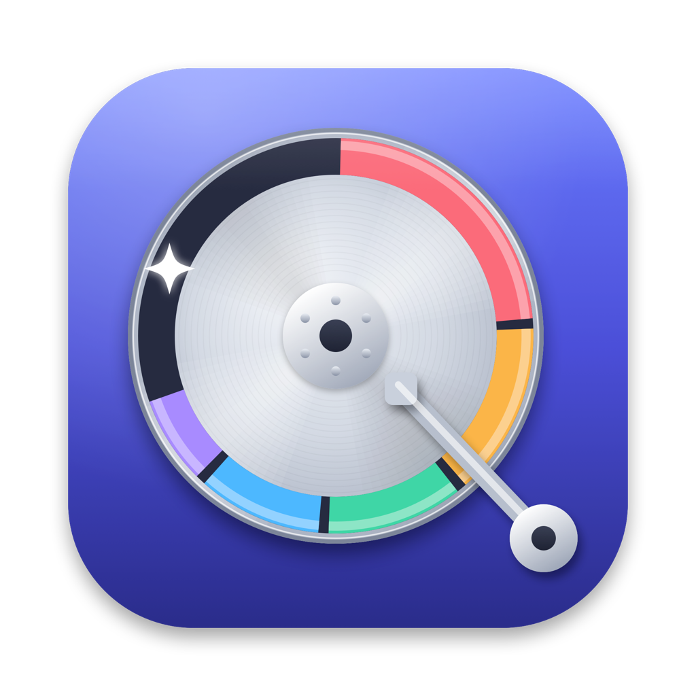

<p align="center"></p>

# Roomy

A macOS app that shows what is using space on your disk and helps you free it up safely.

- **Scan** your home folder, any folder or a whole disk. Folders are read in parallel and hard links are counted once.
- **See** it as a list, a list of the biggest files (filter by kind and age) or a treemap.
- **Clean up** by ticking items and choosing **Review and Clean…**. Items go to the Trash, so Put Back still works.
- **Compress and Clean…** zips items next to themselves, checks that each zip reads back, and only then moves the originals to the Trash. If an item would shrink by less than 10%, it is left alone.
- **Safety rules** (`Sources/RoomyCore/SafetyPolicy.swift`) block system folders, your home folder, Keychains, iCloud Drive, cloud drives and Photos libraries, and warn about Library, Git repositories and running apps.

## Requirements

macOS 14 or later, and Swift 5.10 or later (Xcode or the Command Line Tools).

## Build

```sh
./scripts/build-app.sh            # builds build/Roomy.app and build/Roomy.zip
./scripts/build-app.sh --install  # also copies it to /Applications
open build/Roomy.app
```

The app is signed for local use only, without a developer certificate. On another Mac, right-click the app and choose **Open** the first time.

For complete sizes, give Roomy Full Disk Access in System Settings → Privacy & Security → Full Disk Access.

There is also a command-line scanner:

```sh
swift run roomy-scan ~ --top 20
```

## Releases

Every push to `main` is built on GitHub Actions, and the zipped app is attached to the run.

To publish a version, open **Actions → Release → Run workflow** and pick `patch`, `minor` or `major`. The workflow takes the latest `vX.Y.Z` tag, bumps it (the first release is `v0.1.0`), stamps the version into the app, builds it, tags the commit and publishes a GitHub release with `Roomy-X.Y.Z.zip` and its SHA-256. Pushing a tag such as `v1.2.0` yourself does the same for that version.

## Layout

| Path | What it is |
| --- | --- |
| `Sources/RoomyCore` | Scanner, scan tree, safety policy, cleanup and compression. No UI. |
| `Sources/Roomy` | The SwiftUI app. |
| `Sources/roomy-scan` | Command-line scanner. |
| `scripts/build-app.sh` | Builds and signs the app bundle. |
| `scripts/make-icon.swift` | Draws the app icon and writes `Resources/AppIcon.icns`. |
